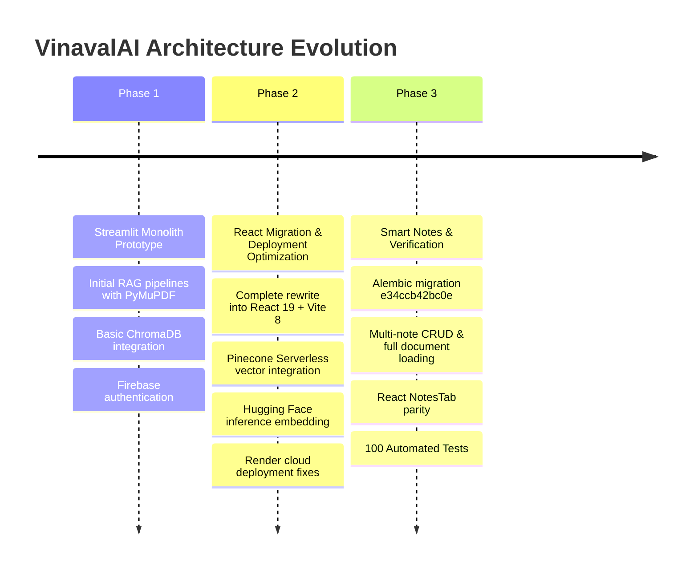
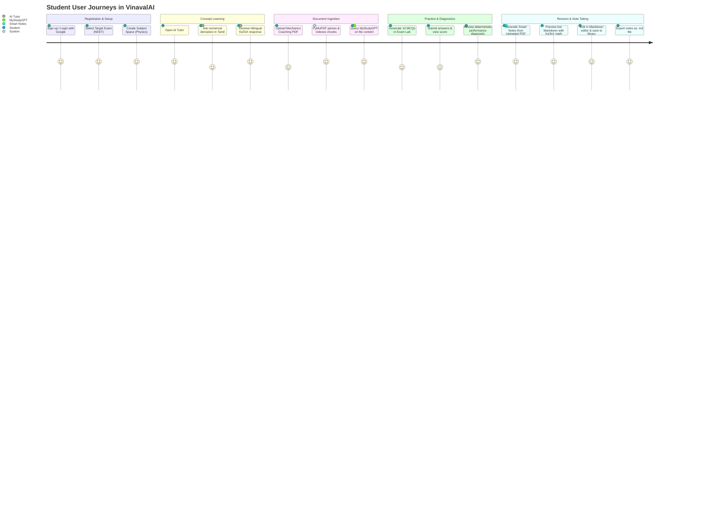
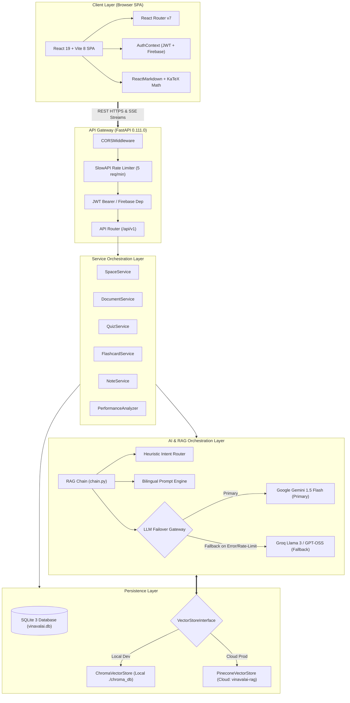
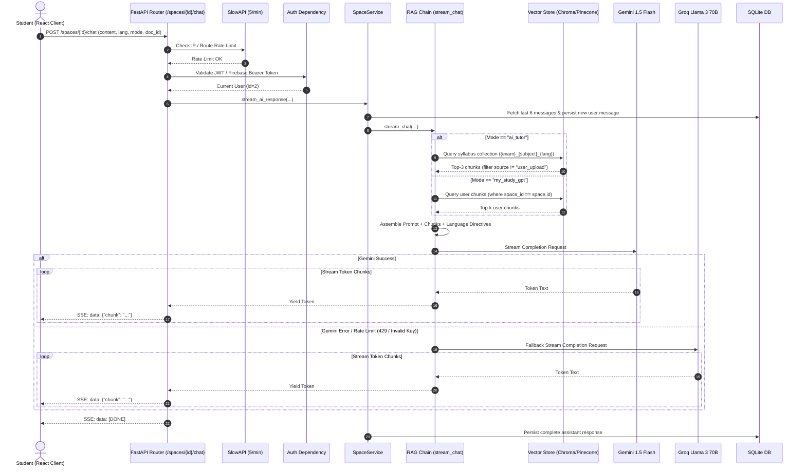
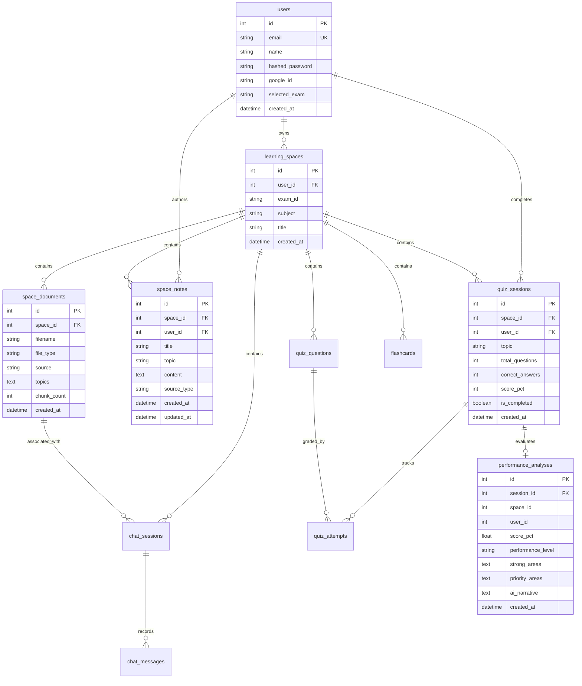
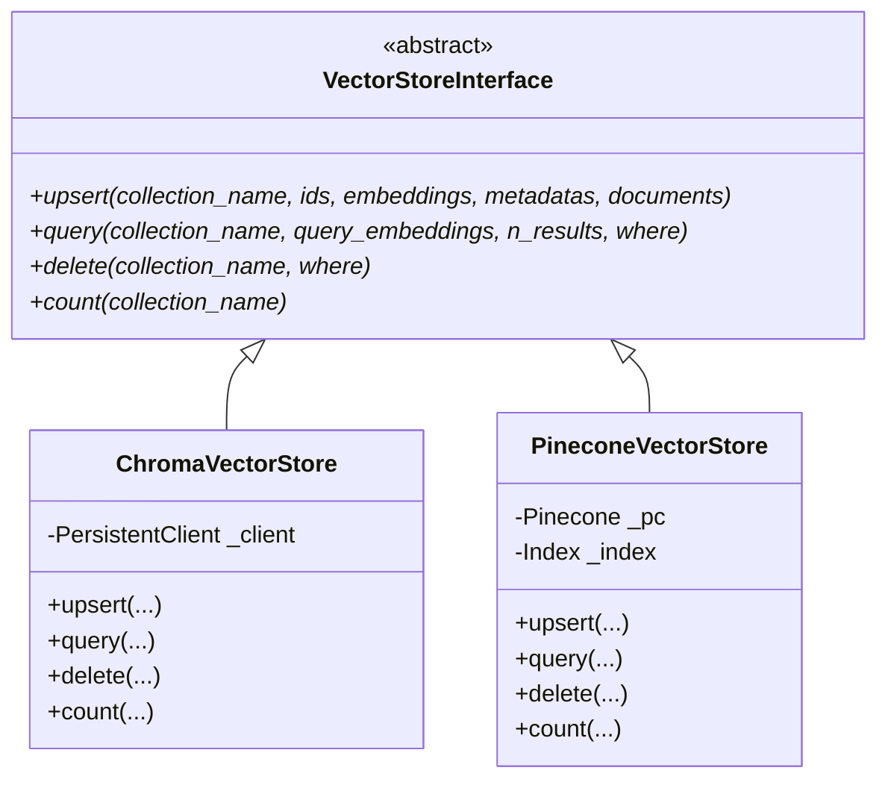
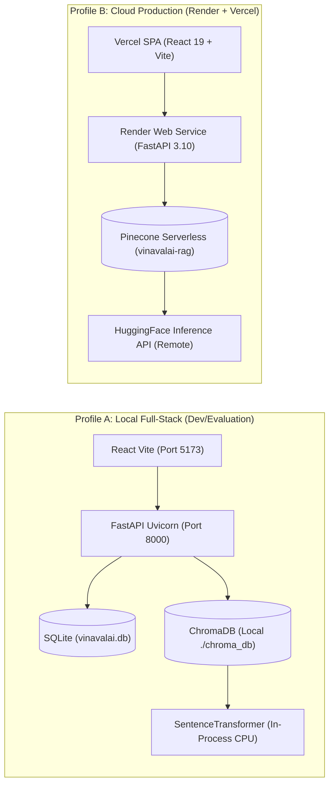

# VinavalAI — Complete Technical and Functional Project Dossier

**Author/Investigator:** Senior Software Architect, AI/ML Research Engineer & Full-Stack Systems Auditor
**Date of Audit & Investigation:** November 2026
**Repository Path:** `/Users/hariprasathc/Projects/vinavalAI`
**Classification:** Definitive Technical & Functional Source of Truth
**Target Audience:** Academic Researchers, Peer Reviewers, Patent Examiners, and Software Architects

---

## Table of Contents
1. [Executive Summary & Project Identity](#1-executive-summary--project-identity)
2. [Background, Real-World Problem & Pedagogical Motivation](#2-background-real-world-problem--pedagogical-motivation)
3. [Repository Development History & Architecture Evolution](#3-repository-development-history--architecture-evolution)
4. [Complete Functional Feature Investigation](#4-complete-functional-feature-investigation)
   - [4.1 Authentication & Session Management](#41-authentication--session-management)
   - [4.2 Examination Selection & Subject Learning Spaces](#42-examination-selection--subject-learning-spaces)
   - [4.3 Module 1: AI Tutor (Curriculum-Grounded Dialogue)](#43-module-1-ai-tutor-curriculum-grounded-dialogue)
   - [4.4 Module 2: MyStudyGPT (User-Document Dialogue & Anti-Hallucination)](#44-module-2-mystudygpt-user-document-dialogue--anti-hallucination)
   - [4.5 Module 3: Materials Management & Semantic Chunk Ingestion](#45-module-3-materials-management--semantic-chunk-ingestion)
   - [4.6 Module 4: Flashcards (Bilingual Active-Recall Cards)](#46-module-4-flashcards-bilingual-active-recall-cards)
   - [4.7 Module 5: Exam Lab (Adaptive MCQ Assessment)](#47-module-5-exam-lab-adaptive-mcq-assessment)
   - [4.8 Module 6: Performance Analytics & Diagnostic Reports](#48-module-6-performance-analytics--diagnostic-reports)
   - [4.9 Module 7: Smart Notes (Dual-Source Grounded Revision System)](#49-module-7-smart-notes-dual-source-grounded-revision-system)
   - [4.10 User Journey Walkthroughs](#410-user-journey-walkthroughs)
5. [System Architecture & Deep Dive](#5-system-architecture--deep-dive)
   - [5.1 High-Level Architecture](#51-high-level-architecture)
   - [5.2 Complete Request Lifecycle](#52-complete-request-lifecycle)
   - [5.3 Frontend Architecture (React 19 + Vite 8)](#53-frontend-architecture-react-19--vite-8)
   - [5.4 Backend Architecture (FastAPI + Async IO)](#54-backend-architecture-fastapi--async-io)
   - [5.5 Relational Data Persistence (SQLAlchemy + Alembic)](#55-relational-data-persistence-sqlalchemy--alembic)
   - [5.6 Vector Store Abstraction & Memory Isolation](#56-vector-store-abstraction--memory-isolation)
   - [5.7 Retrieval-Augmented Generation (RAG) Architecture](#57-retrieval-augmented-generation-rag-architecture)
   - [5.8 Dual-LLM Gateway & Automated Failover](#58-dual-llm-gateway--automated-failover)
6. [Security, Engineering Quality & Operational Vulnerabilities](#6-security-engineering-quality--operational-vulnerabilities)
7. [Deployment Architecture & Environment Profiles](#7-deployment-architecture--environment-profiles)

---

## 1. Executive Summary & Project Identity

**VinavalAI** (derived from the Tamil word *வினவல்* [Vinaval], meaning "inquiry", "questioning", or "interrogation") is a domain-specific, bilingual (English and Tamil) educational learning and assessment platform designed specifically for competitive entrance and civil service recruitment examinations in Tamil Nadu, India:
1. **NEET (National Eligibility cum Entrance Test):** The nationwide pre-medical entrance examination covering Physics, Chemistry, and Biology (Botany & Zoology) based on the NCERT/CBSE secondary syllabus.
2. **TNPSC (Tamil Nadu Public Service Commission):** The state-level administrative civil service recruitment examinations covering General Studies (History, Polity, Geography, Economy, General Science) and Tamil Literature/Heritage.

The platform provides an integrated learning environment combining:
- **Dual-Source Retrieval-Augmented Generation (RAG):** Disconnecting and context-switching between authoritative curriculum-standard textbooks and student-uploaded private study materials (`.pdf`, `.txt`).
- **Bilingual Pedagogical Synthesis:** Native handling of Tamil script (`[\u0B80-\u0BFF]`) with parenthetical English technical terminology transliteration.
- **Server-Sent Events (SSE) Streaming:** Progressive delivery of dynamic learning dialogue, active-recall flashcards, and multiple-choice questions (MCQs) utilizing custom brace-counting JSON parsing automata.
- **Deterministic Diagnostic Analytics:** Hybrid performance profiling combining algorithmic accuracy and speed metrics with qualitative LLM mentor critiques.
- **Smart Notes Revision Engine:** An automated note synthesis pipeline with exhaustive document chunk ingestion, inline LaTeX math formula rendering (`$...$`), space-isolated database persistence, and client-side Markdown (`.md`) export.

---

## 2. Background, Real-World Problem & Pedagogical Motivation

### 2.1 The Educational Landscape in Tamil Nadu
Students preparing for high-stakes competitive examinations in regional Indian contexts face severe structural and pedagogical hurdles:
1. **The Regional Language Divide:** While NCERT and State Board textbooks are published in both English and Tamil, technical terminology in physics, organic chemistry, and cellular biology is difficult to master in Tamil alone. Competitive exam question papers frequently use English transliterations or parallel bilingual framing. Conventional commercial AI chatbots (e.g., standard ChatGPT or Gemini web interfaces) either translate science terms literally into archaic literary Tamil or hallucinate colloquial formulations, causing severe exam confusion.
2. **Context Starvation and Hallucination Risks:** Medical entrance examinations require absolute factual fidelity to the prescribed NCERT textbooks. General-purpose LLMs generate explanations that may be scientifically sound in general university physics but contradict the specific conventions, notation, or syllabus boundaries tested by the National Testing Agency (NTA).
3. **Fragmented Study Workflows:** Students typically juggle disparate tools:
   - A PDF reader for digital textbooks and coaching notes;
   - An LLM chat interface for doubt clearance (frequently hallucinating outside the syllabus);
   - A separate quiz app for test practice;
   - Physical notebooks or generic note-taking applications for revision summaries.
4. **Information Overload and Revision Bottlenecks:** A standard NEET preparation cycle encompasses 97 textbook chapters across Physics, Chemistry, and Biology. Synthesizing dense, high-yield revision notes from 300-page textbooks or 50-page coaching handouts is time-consuming, leading to cognitive fatigue before exams.

### 2.2 The VinavalAI Solution
VinavalAI unifies these workflows into an integrated, subject-isolated web environment. By grounding all interactions in curated syllabus collections or user-uploaded PDF materials, enforcing bilingual domain terminology, providing progressive active-recall generation, and enabling one-click structured note synthesis, the platform transforms static reading materials into an active, verified study environment.

---

## 3. Repository Development History & Architecture Evolution

A git commit and artifact inspection establishes that VinavalAI evolved across three distinct phases:

### Key Architectural Evolution Steps:
1. **Initial Prototype (Commits `b69ddf4` – `e1945d8`):** Developed as a rapid Python prototype using Streamlit (`frontend/app.py`, `frontend/pages/`). It proved the viability of ChromaDB vector retrieval, PyMuPDF text parsing, and Gemini-based chat.
2. **React 19 + Vite 8 Rewrite (Commit `65a7fc9`):** Recognizing the limitations of Streamlit's full-page rerun execution model for streaming chats, 3D card flipping, and modal multi-space navigation, the entire student-facing interface was rewritten as a modern Single-Page Application (SPA) using React 19, Vite 8, and React Router v7 (`frontend/src/`).
3. **Cloud Memory Optimization & Vector Decoupling (Commits `e124d8d` – `de3b422`):** When deploying the FastAPI backend to Render's free tier (512 MB RAM ceiling), loading `sentence-transformers/paraphrase-multilingual-MiniLM-L12-v2` locally with PyTorch in-process caused immediate Out-Of-Memory (OOM) crashes (~1.13 GB RSS). The team engineered a modular `VectorStoreInterface` supporting both local ChromaDB and cloud Pinecone (`vinavalai-rag`), pairing Pinecone with a serverless `HuggingFaceInferenceEmbedding` client that reduced the application memory footprint to ~180 MB.
4. **Smart Notes & Full-Stack Completion (Commits `4d536d5`):** Expanded the backend from a single raw text scratchpad into an end-to-end grounded revision engine with Alembic migration `e34ccb42bc0e`, exhaustive document chunk extraction, KaTeX math formula rendering, and full CRUD library management in React.

---

## 4. Complete Functional Feature Investigation

The application is structured around a centralized Dashboard managing isolated **Learning Spaces** per subject. Within each Space, seven distinct functional modules are available.

### 4.1 Authentication & Session Management
- **Purpose:** Secure student identity, isolate learning materials, and manage access tokens.
- **Implementation:** Dual-mode authentication:
  1. *Email/Password:* Native registration (`POST /api/v1/auth/signup`) and authentication (`POST /api/v1/auth/login`) using salted bcrypt passwords and HS256 JSON Web Tokens (access token valid for 60 min, refresh token valid for 30 days).
  2. *Google OAuth:* Google Sign-In via Firebase Web SDK; the resulting ID token is validated on the backend using `firebase_admin.auth.verify_id_token` (`POST /api/v1/auth/firebase`).
- **Frontend Layer:** Handled by [`AuthContext.jsx`](file:///Users/hariprasathc/Projects/vinavalAI/frontend/src/context/AuthContext.jsx) and [`api.js`](file:///Users/hariprasathc/Projects/vinavalAI/frontend/src/services/api.js). `api.js` automatically intercepts HTTP 401 responses and triggers `refreshAuthToken()` transparently before re-executing failed requests.

### 4.2 Examination Selection & Subject Learning Spaces
- **Purpose:** Contextualize the learning curriculum according to the student's target examination.
- **Implementation:**
  - Examination definitions are stored in [`backend/app/core/constants.py`](file:///Users/hariprasathc/Projects/vinavalAI/backend/app/core/constants.py):
    - `NEET`: Physics, Chemistry, Biology (Botany & Zoology).
    - `TNPSC`: General Studies (History, Indian Polity, Geography, Economy, General Science) and Aptitude.
  - The student creates dedicated **Learning Spaces** (`POST /api/v1/spaces`). Each Space is bound to an `exam_id`, a `subject`, and a `user_id`. All downstream materials, chat threads, quiz sessions, flashcards, and notes are strictly scoped by `space_id`.

### 4.3 Module 1: AI Tutor (Curriculum-Grounded Dialogue)
- **Purpose:** Serve as a 24/7 bilingual subject matter expert answering conceptual and numerical questions grounded strictly in the official curriculum.
- **User Workflow:** Student navigates to the AI Tutor tab, enters a conceptual inquiry (e.g., *"Explain Young's Double Slit Experiment and derive fringe width"* or *"ஒளியின் குறுக்கீட்டு விளைவு என்றால் என்ன?"*), and receives a progressively rendered streaming response formatted in structured Markdown with KaTeX formulas.
- **RAG Pipeline:**
  - Queries the pre-seeded syllabus vector collections (`{exam}_{subject}_{lang}`).
  - Retrieves top-$k=3$ dense chunks ($384$ dimensions).
  - Post-filters to ensure no user-uploaded documents contaminate official curriculum answers.
  - Injects chunks into `SYSTEM_PROMPT` ([`chain.py:272`](file:///Users/hariprasathc/Projects/vinavalAI/backend/app/rag/chain.py#L272)), enforcing analogies, step-by-step mathematical working, and English scientific terms in parentheses when answering in Tamil.
- **Status & Constraints:** Fully functional for NEET. For TNPSC, the backend logic is complete, but the React frontend renders a `<TnpscComingSoon />` placeholder banner ([`SharedChatTab.jsx:462`](file:///Users/hariprasathc/Projects/vinavalAI/frontend/src/components/Space/SharedChatTab.jsx#L462)).

### 4.4 Module 2: MyStudyGPT (User-Document Dialogue & Anti-Hallucination)
- **Purpose:** Enable deep, conversational interaction with user-uploaded coaching notes, lecture handouts, and institutional study guides.
- **User Workflow:** Student selects a document from the Space or clicks "Chat with this File". The dialogue is strictly restricted to the content of that specific file.
- **Strict Anti-Hallucination Guardrails:**
  - Operates under `DOCUMENT_SYSTEM_PROMPT` ([`chain.py:313`](file:///Users/hariprasathc/Projects/vinavalAI/backend/app/rag/chain.py#L313)).
  - Explicitly instructs the LLM: *"Answer STRICTLY based on the content provided in the Context from Your Study Materials section below. Do NOT use general training knowledge or assume outside facts."*
  - **Explicit Negative Refusal:** If the query cannot be answered from the retrieved document chunks, the system yields:
    > *"I couldn't find enough relevant information in your selected materials to answer this confidently. Try selecting a relevant material or asking about a topic covered in it."*
  - Hallucination substitution from external textbooks or general pre-training memory is strictly prohibited by system prompt constraints.

### 4.5 Module 3: Materials Management & Semantic Chunk Ingestion
- **Purpose:** Ingest, parse, index, and organize user study materials into isolated vector spaces.
- **User Workflow:** In the Materials tab, students upload `.pdf` or `.txt` files (enforced maximum size: 10 MB). The file is uploaded via `multipart/form-data` to `POST /api/v1/spaces/{id}/documents`.
- **Parsing Hierarchy:**
  1. *PyMuPDF (`fitz`):* Primary parser for Tamil and English text, extracting raw Unicode without glyph corruption.
  2. *pdfplumber:* Fallback parser for complex multicolumn or tabular layouts.
  3. *RapidOCR (`rapidocr_onnxruntime`):* Optional OCR engine for scanned image PDFs.
- **Heuristic Heading & Topic Extractor:** Scans extracted text lines against length constraints ($3 \le \text{length} \le 80$) and whitespace patterns to identify topic boundaries, stored as a JSON list in `space_documents.topics`.
- **Semantic Section Chunking:** Splits text at detected topic boundaries. If a section exceeds $2500$ characters, it falls back to sentence/paragraph splitting with a $400$-character sliding overlap.
- **Vector Indexing:** Chunks are embedded via `paraphrase-multilingual-MiniLM-L12-v2` and inserted into the active vector store with metadata payload `{"doc_id": doc.id, "space_id": space.id, "source": "user_upload"}`.
- **Deletion:** Calling `DELETE /api/v1/spaces/{id}/documents/{did}` cascades deletion to the relational record in SQLite and executes `vector_store.delete(where={"doc_id": did})`.

### 4.6 Module 4: Flashcards (Bilingual Active-Recall Cards)
- **Purpose:** Support high-yield active-recall memorization for key definitions, formulas, and historical dates.
- **User Workflow:** Student selects a topic, count ($1$ to $20$), and language (English or Tamil), then clicks "Generate Flashcards".
- **Progressive SSE Streaming:** Employs `POST /api/v1/spaces/{id}/flashcards/generate`. The backend prompts the LLM to output flat NDJSON objects: `{"front": "...", "back": "..."}`.
- **Brace-Counting Parser:** Instead of awaiting completion of an entire JSON array, a streaming parser counts open and closing curly braces (`{` and `}`), isolates complete JSON objects on the fly, validates them, and yields them as SSE events (`event: flashcard`).
- **Interactive UI:** Rendered in [`FlashcardsTab.jsx`](file:///Users/hariprasathc/Projects/vinavalAI/frontend/src/components/Space/FlashcardsTab.jsx) with CSS 3D perspective transform flip animations, front/back reveals, and local database caching.

### 4.7 Module 5: Exam Lab (Adaptive MCQ Assessment)
- **Purpose:** Test conceptual understanding through mock multiple-choice question sets with automated grading and detailed answer rationales.
- **User Workflow:** Student chooses question count ($5$ to $30$), topic, and language, then takes an un-timed or timed test.
- **Generation & Parsing:** `POST /api/v1/spaces/{id}/quiz/generate` streams MCQs using the same brace-counting parser, extracting `{"question": "...", "option_a": "...", "option_b": "...", "option_c": "...", "option_d": "...", "correct_option": "...", "explanation": "..."}`.
- **Attempt Grading:** Each answer is submitted to `POST /api/v1/spaces/{id}/quiz/attempt`, evaluated against `correct_option`, and stored in `quiz_attempts` with `time_taken_seconds`.

### 4.8 Module 6: Performance Analytics & Diagnostic Reports
- **Purpose:** Deliver objective, actionable diagnostics of student strengths, weaknesses, and time management.
- **Hybrid Diagnostic Engine:**
  - **Deterministic Engine ([`performance_analyzer.py`](file:///Users/hariprasathc/Projects/vinavalAI/backend/app/services/performance_analyzer.py)):** Calculates score percentage, topic-by-topic accuracy, mistake patterns (e.g., conceptual confusion vs calculation error), average time per question, and classifies areas into:
    - *Strong Areas:* Accuracy $\ge 80\%$.
    - *Developing Areas:* $55\% \le \text{Accuracy} < 80\%$.
    - *Priority Areas:* Accuracy $< 55\%$.
  - **AI Mentor Narrative:** The structured diagnostic metrics JSON is injected into an LLM prompt (`PERFORMANCE_ANALYSIS_SYSTEM`), synthesizing an encouraging, pedagogical critique that highlights specific chapters requiring immediate revision.
  - **Visualization:** Displayed in [`ResultAnalysisPanel.jsx`](file:///Users/hariprasathc/Projects/vinavalAI/frontend/src/components/Space/ResultAnalysisPanel.jsx) with accuracy gauges, priority tags, and direct links to launch targeted revision.

### 4.9 Module 7: Smart Notes (Dual-Source Grounded Revision System)
- **Purpose:** Synthesize, edit, organize, and export comprehensive revision notes grounded in syllabus standards or user PDFs.
- **Dual Knowledge Source Architecture:**
  1. *Curriculum Grounding:* Generates high-yield notes from pre-seeded textbook vector collections for any chosen topic.
  2. *Document Grounding:* Generates notes grounded in a student-uploaded document. Crucially, the system first calls `_load_all_doc_chunks(exam, subject, doc_id)`, retrieving **all stored chunks** ordered by `chunk_index`. This bypasses vector similarity search, ensuring full document synthesis without coverage gaps. It falls back to vector similarity search ($n=8$) only if 0 chunks are returned.
- **Synthesis Capabilities:**
  - Strict Markdown structure: Executive Overview, Definitions & Core Concepts Table, Formulas & High-Yield Points, Key Takeaways.
  - Native bilingual output: Tamil synthesis embeds English scientific terms in parentheses.
  - KaTeX LaTeX formatting: Equations are wrapped in standard `$...$` syntax.
- **CRUD Library Persistence:**
  - Saved to the relational SQLite table `space_notes` (schema: `id`, `space_id`, `user_id`, `title`, `topic`, `content`, `source_type`, `created_at`, `updated_at`).
  - Searchable via real-time keyword query (`GET /api/v1/spaces/{id}/notes?search=...`).
  - Single-click local export as standard `.md` file with sanitized slugs.

---

### 4.10 User Journey Walkthroughs

---

## 5. System Architecture & Deep Dive

### 5.1 High-Level Architecture

---

### 5.2 Complete Request Lifecycle

The following sequence diagram illustrates an authenticated streaming chat interaction with automated LLM failover:

---

### 5.3 Frontend Architecture (React 19 + Vite 8)

The frontend is a single-page application built on React 19 and bundled via Vite 8:

| Component / File | Purpose & Responsibilities | Key Backend Endpoints |
|---|---|---|
| [`App.jsx`](file:///Users/hariprasathc/Projects/vinavalAI/frontend/src/App.jsx) | Client-side routing, route protection (`ProtectedRoute`), parameter routing | N/A |
| [`AuthContext.jsx`](file:///Users/hariprasathc/Projects/vinavalAI/frontend/src/context/AuthContext.jsx) | User session state, JWT/Firebase persistence in `localStorage`, logout | `/api/v1/auth/login`, `/signup`, `/firebase` |
| [`api.js`](file:///Users/hariprasathc/Projects/vinavalAI/frontend/src/services/api.js) | Centralized fetch wrapper, automatic JWT 401 refresh interceptor, SSE stream generators | All `/api/v1/*` endpoints |
| [`Space.jsx`](file:///Users/hariprasathc/Projects/vinavalAI/frontend/src/pages/Space.jsx) | Learning space master container, 7-item navigation sidebar, dynamic tab switching | `/api/v1/spaces/{id}` |
| [`SharedChatTab.jsx`](file:///Users/hariprasathc/Projects/vinavalAI/frontend/src/components/Space/SharedChatTab.jsx) | Unified streaming dialogue UI for AI Tutor and MyStudyGPT, KaTeX rendering | `POST /api/v1/spaces/{id}/chat` |
| [`MaterialsTab.jsx`](file:///Users/hariprasathc/Projects/vinavalAI/frontend/src/components/Space/MaterialsTab.jsx) | PDF/TXT drag-and-drop file upload, file list, chunk counts, topic tags | `POST/GET/DELETE /spaces/{id}/documents` |
| [`FlashcardsTab.jsx`](file:///Users/hariprasathc/Projects/vinavalAI/frontend/src/components/Space/FlashcardsTab.jsx) | 3D interactive flip card viewer, progressive SSE generation | `POST /spaces/{id}/flashcards/generate` |
| [`ExamLabTab.jsx`](file:///Users/hariprasathc/Projects/vinavalAI/frontend/src/components/Space/ExamLabTab.jsx) | Timed/untimed MCQ test simulator, option selection, attempt submission | `POST /spaces/{id}/quiz/generate`, `/attempt` |
| [`ResultAnalysisPanel.jsx`](file:///Users/hariprasathc/Projects/vinavalAI/frontend/src/components/Space/ResultAnalysisPanel.jsx) | Diagnostic report displaying accuracy, strong/weak areas, AI critique | `POST /spaces/{id}/quiz/sessions/{sid}/complete` |
| [`NotesTab.jsx`](file:///Users/hariprasathc/Projects/vinavalAI/frontend/src/components/Space/NotesTab.jsx) | Smart Notes two-tab interface (Generate & Edit, Saved Library), KaTeX reader | `POST /spaces/{id}/notes/generate`, CRUD `/notes` |

---

### 5.4 Backend Architecture (FastAPI + Async IO)

The backend is built with FastAPI 0.111.0 running on Uvicorn 0.29.0.

#### Router Organization:
- Aggregated in [`backend/app/api/v1/__init__.py`](file:///Users/hariprasathc/Projects/vinavalAI/backend/app/api/v1/__init__.py):
  - `auth_router` (`/auth`): Signup, login, firebase token exchange, refresh, password reset.
  - `exam_router` (`/exams`): Exam definitions, user active exam selection.
  - `space_router` (`/spaces`): Spaces CRUD, chat sessions, SSE streaming chat.
  - `document_router` (`/spaces/{id}/documents`): Document upload, extraction, listing, deletion.
  - `quiz_router` (`/spaces/{id}/quiz`): MCQ generation, submission grading, sessions, diagnostics.
  - `flashcard_router` (`/spaces/{id}/flashcards`): Flashcard streaming generation and listing.
  - `note_router` (`/spaces/{id}/notes`): Smart Notes generation, CRUD persistence, search.

#### Middleware & Security Pipeline:
1. **CORSMiddleware:** Configured in `main.py:237` with origins including `http://localhost:5173`, `http://127.0.0.1:5173`, and Vercel domains.
2. **SlowAPI Rate Limiter:** Enforces strict client rate limiting (default 5 requests/minute on all generative endpoints: chat, quiz, flashcards, notes) using `get_remote_address`.
3. **Authentication Dependency:** [`dependencies.py:get_current_user`](file:///Users/hariprasathc/Projects/vinavalAI/backend/app/core/dependencies.py) verifies Bearer tokens (HS256 JWT or Firebase Google OAuth token), retrieving the active `User` record from SQLite.

---

### 5.5 Relational Data Persistence (SQLAlchemy + Alembic)

The database layer utilizes **SQLite 3** (`vinavalai.db`) accessed via **SQLAlchemy 2.0.30** declarative models with asynchronous IO via **aiosqlite 0.20.0**.

#### Entity-Relationship Diagram:

#### Alembic Migration History (16 Versions):
The schema is managed by Alembic in `backend/alembic/versions/`. The migration lineage culminates at current head **`e34ccb42bc0e`**:
1. `85059d9f8e5f`: Initial users and spaces schema.
2. `7393437dff75`: Chat sessions and messages.
3. `69c3a371ba10`: Space documents and vector metadata.
4. `96c813beee28`: Quizzes and attempt tracking.
5. `406b23d9a1f7`: Flashcards table.
6. `f1b952c4232a`: Performance analyses schema.
7. ... through ...
8. **`e34ccb42bc0e_expand_smart_notes.py` (Current Head):** Dropped SQLite table-level `UNIQUE (space_id)` constraint via batch alter table with naming convention `uq_%(table_name)s_%(column_0_name)s`, added `title`, `topic`, `source_type`, `user_id`, and `created_at` to support full multi-note CRUD operations per space.

---

### 5.6 Vector Store Abstraction & Memory Isolation

To balance low-cost local development with cloud production resource ceilings, the vector storage layer is encapsulated behind an abstract base class ([`vector_store.py:VectorStoreInterface`](file:///Users/hariprasathc/Projects/vinavalAI/backend/app/core/vector_store.py#L32)).

- **ChromaVectorStore (Local Mode):** Connects to SQLite-backed ChromaDB in `./chroma_db`. Uses in-process `SentenceTransformer("sentence-transformers/paraphrase-multilingual-MiniLM-L12-v2")` running on CPU.
- **PineconeVectorStore (Cloud Mode):** Connects to serverless Pinecone index `vinavalai-rag` on AWS `us-east-1` (384 dimensions, cosine distance). It replaces the local PyTorch model with `HuggingFaceInferenceEmbedding` calling the Hugging Face Inference API over HTTP. As proven by `test_pinecone_memory_isolation.py`, neither ChromaDB nor SentenceTransformers are imported or initialized when `VECTOR_STORE_PROVIDER=pinecone`, slashing RAM from $1.13\text{ GB}$ down to $\sim 180\text{ MB}$.

---

### 5.7 Retrieval-Augmented Generation (RAG) Architecture

#### Embedding Configuration
- **Model:** `sentence-transformers/paraphrase-multilingual-MiniLM-L12-v2`.
- **Vector Dimension:** $384$.
- **Distance Metric:** Cosine Similarity ($\text{sim}(u, v) = \frac{u \cdot v}{\|u\| \|v\|}$).
- **Cross-Lingual Alignment:** Pre-trained on parallel multi-million sentence pairs across 50+ languages, allowing English queries to semantically match Tamil textbook chunks and vice versa.

#### Dual-Tier Retrieval Execution
1. **Tier 1: Pre-Seeded Syllabus Collections (`neet_physics`, `neet_physics_ta`, etc.):**
   - Populated from official textbooks via [`scripts/seed_books.py`](file:///Users/hariprasathc/Projects/vinavalAI/backend/scripts/seed_books.py).
   - In AI Tutor mode, queries search all language collections for that exam/subject. Top-$k=3$ chunks are retrieved. Post-filtering discards any chunk tagged with `source: user_upload`.
2. **Tier 2: User Document Collections:**
   - Ingested via Materials upload with metadata `space_id: space.id` and `doc_id: doc.id`.
   - In MyStudyGPT mode, queries enforce metadata filtering (`where={"doc_id": doc_id}` or `where={"space_id": space_id}`). If $0$ chunks match, the system yields the mandatory refusal message.

---

### 5.8 Dual-LLM Gateway & Automated Failover

To guarantee high availability and bypass API provider quota exhaustion, all LLM invocations (streaming and non-streaming) are routed through a failover gateway in [`backend/app/rag/chain.py`](file:///Users/hariprasathc/Projects/vinavalAI/backend/app/rag/chain.py):

| Gateway Route | Primary Provider | Primary Model | Fallback Provider | Fallback Model | Trigger Conditions |
|---|---|---|---|---|---|
| Non-Streaming (`_llm_complete`) | Google Gemini | `gemini-1.5-flash` | Groq | `llama-3.3-70b-versatile` | Gemini exception, HTTP 429, invalid API key, timeout |
| Streaming Chat (`stream_chat`) | Google Gemini | `gemini-1.5-flash` | Groq | `llama-3.3-70b-versatile` | Gemini stream failure or rate limit |
| Streaming Objects (MCQ/Cards) | Groq | `openai/gpt-oss-120b` | Google Gemini | `gemini-1.5-flash` | Groq format parse error or rate limit |

In the local environment, `GEMINI_API_KEY` is set to `INVALID`, ensuring that all runtime requests seamlessly exercise the Groq fallback path with verified generation times of $2.5$ to $4.0$ seconds.

---

## 6. Security, Engineering Quality & Operational Vulnerabilities

An exhaustive code audit reveals several critical security and stability considerations:

1. **Horizontal Authorization Bypass (IDOR) in Batch Quiz Statistics:**
   - *Location:* [`backend/app/api/v1/quiz.py:30-38`](file:///Users/hariprasathc/Projects/vinavalAI/backend/app/api/v1/quiz.py#L30-L38) & [`quiz_repository.py:144-185`](file:///Users/hariprasathc/Projects/vinavalAI/backend/app/repositories/quiz_repository.py#L144-L185).
   - *Vulnerability:* The endpoint `GET /spaces/quiz/stats/batch?space_ids=1&space_ids=2` queries attempt stats using `QuizAttempt.space_id.in_(space_ids)` without validating that the requested spaces belong to `current_user.id`. Any logged-in student can enumerate space IDs and view other students' performance statistics.
2. **Missing Space Ownership Verification in Quiz Attempt Grading:**
   - *Location:* [`backend/app/services/quiz_service.py:207-213`](file:///Users/hariprasathc/Projects/vinavalAI/backend/app/services/quiz_service.py#L207-L213).
   - *Vulnerability:* When grading an attempt via `POST /spaces/{space_id}/quiz/attempt`, the handler updates `QuizSession.correct_answers` if `session_id` is supplied without confirming `session.space_id == space.id`.
3. **Multi-Tenant Logical Colocation in Vector Store:**
   - *Location:* [`backend/app/services/document_service.py:246`](file:///Users/hariprasathc/Projects/vinavalAI/backend/app/services/document_service.py#L246).
   - *Vulnerability:* User-uploaded documents and official syllabus books reside in the same ChromaDB collection (e.g. `neet_physics_en`), separated solely by metadata `{"space_id": space_id}`. A software bug or malformed query omitting the `where` filter risks leaking private student materials across user accounts.
4. **Ephemeral Database Storage Risk on Render:**
   - *Location:* [`render.yaml:49`](file:///Users/hariprasathc/Projects/vinavalAI/render.yaml#L49).
   - *Vulnerability:* The production deployment configuration specifies `DATABASE_URL=sqlite+aiosqlite:///./vinavalai.db`. Render Web Services utilize an ephemeral filesystem; on every deployment or server restart, all user accounts, quiz attempts, and notes stored in SQLite are permanently lost unless migrated to managed PostgreSQL.

---

## 7. Deployment Architecture & Environment Profiles

VinavalAI supports two distinct deployment profiles:

- **Local Profile:** Employs ChromaDB and in-process PyTorch sentence embeddings. Requires zero external cloud database keys for vector search.
- **Cloud Profile:** Utilizes Vercel for frontend hosting (`vercel.json` SPA rewrites), Render for backend hosting (`render.yaml`), Pinecone for vector indexing, and serverless Hugging Face embeddings to maintain memory consumption below 512 MB.
