# Patent Invention Disclosure Report

**Document Type:** Formal Invention Disclosure & Technical Specification for Patent Cell Review
**Project Reference:** VinavalAI
**Date of Disclosure:** November 2026
**Document Ref:** `docs/research_and_patent/03_vinavalai_patent_invention_disclosure.md`
**Notice:** This document is prepared for institutional evaluation by registered patent attorneys and patent agents. It does not constitute a legal patent filing and does not guarantee patentability.

---

## 1. Invention Title
**A Dual-Tier Retrieval-Augmented Generation System and Method for Multilingual Pedagogical Tutoring, Progressive Object Streaming, and Exhaustive Document Synthesis**

---

## 2. Technical Field
The present invention relates generally to natural language processing, intelligent tutoring systems, and distributed database information retrieval. More particularly, the invention relates to a system and method for:
- Context-switched, multi-tier Retrieval-Augmented Generation (RAG) providing strict domain grounding and negative constraint enforcement;
- Exhaustive document chunk extraction and sequential stitching for complete pedagogical revision note synthesis;
- Pushdown automata for real-time progressive stream-decoding of structured JSON objects over Server-Sent Events (SSE); and
- Decoupled, memory-transmutable vector storage enabling dynamic execution across constrained edge/cloud memory tiers.

**International Patent Classification (IPC):**
- **G06F 16/33** (Information retrieval; Querying)
- **G06N 3/00** (Computer systems based on biological models / Artificial Intelligence)
- **G06N 20/00** (Machine Learning)
- **G09B 7/02** (Electrically-operated teaching apparatus providing interactive evaluation)
- **H04L 67/02** (Network architectures or protocols for web-based services)

---

## 3. Background of the Invention & Prior Art Limitations

Retrieval-Augmented Generation (RAG) architectures traditionally combine a dense vector index with a generative Large Language Model (LLM). Given a query, a vector database computes cosine similarity across stored chunks, selects the top-$k$ nearest neighbors, and injects those chunks into the LLM context prompt.

While effective for broad open-domain question answering, conventional RAG systems exhibit critical technical deficiencies when applied to domain-specific, high-stakes educational environments:

1. **Context Starvation during Macro-Synthesis:** Top-$k$ similarity retrieval is inherently lossy. When a student requests comprehensive revision notes, a chapter summary, or a formula sheet from an uploaded document, standard RAG retrieves only $k$ fragmented chunks (e.g., $k=3$ or $k=5$). Large portions of the document are omitted, producing incomplete revision summaries with significant gaps in technical coverage.
2. **Pedagogical Hallucination & Scope Poisoning:** Conventional chatbots lack strict negative grounding boundaries. When queried on a topic absent from the reference document, general-purpose models compensate by drawing upon their parametric pre-training weights, hallucinating facts outside the student's specific syllabus.
3. **Structured Generative Latency (The Array Waiting Penalty):** In interactive testing environments, generating structured pedagogical artifacts (such as a 10-question multiple-choice exam or 5 flashcards) typically requires the model to output a complete JSON array: `[ {...}, {...}, {...} ]`. Downstream parsers cannot parse the stream until the terminal closing bracket (`]`) is generated, introducing high First-Token Latency (TTFT) and degrading interactive student engagement.
4. **Memory Ceilings in Constrained Cloud Environments:** Dense multilingual embedding models (e.g., SentenceTransformers) typically require loading deep PyTorch transformer runtimes in-process, consuming $1.0\text{ GB}$ to $1.5\text{ GB}$ of RAM. In low-cost serverless or free-tier containerized environments (such as Render's $512\text{ MB}$ RAM ceiling), this causes immediate Out-Of-Memory (OOM) fatal crashes.

---

## 4. Technical Problems Addressed

| Problem ID | Technical Problem Description | Manifestation in Prior Art |
|---|---|---|
| **TP-1** | Selective Lossiness in Document-Grounded RAG | Top-$k$ similarity heuristics retrieve isolated chunks, starving macro-synthesis of full-document context. |
| **TP-2** | Unbounded Pre-Training Memory Bleed | Inability of LLMs to refuse out-of-document queries without falling back to pre-training memory. |
| **TP-3** | Buffering Latency in Structured Streaming | Inability to emit valid, individually parseable JSON objects incrementally during active generation. |
| **TP-4** | In-Process Memory Bloat in Multilingual Vector Search | PyTorch embedding weights exceed container memory ceilings on edge/cloud nodes. |
| **TP-5** | Regional Vocabulary Fragmentation | Lack of systematic mechanism to enforce bilingual vernacular script alongside parenthetical scientific terminology. |

---

## 5. Summary of the Proposed Invention

The present invention provides an integrated system, computer-implemented method, and non-transitory computer-readable medium solving the aforementioned technical problems through four interconnected subsystems:

1. **Exhaustive Sequential Document Assembly Subsystem:** An inverted retrieval pipeline that inspects the requested task intent. For document-wide synthesis tasks (such as Smart Notes), the system bypasses top-$k$ vector similarity search entirely, querying all chunk records assigned to the target document identifier, sorting the chunks deterministically by `chunk_index`, and sequentially constructing an exhaustive context window. Vector similarity search is relegated strictly to an emergency fallback tier if zero indexed chunks are returned.
2. **Negative Constraint Grounding Gatekeeper:** A prompt-engineering and validation pipeline enforcing strict negative refusals when user queries cannot be supported by retrieved study material chunks, preventing out-of-syllabus hallucination.
3. **Pushdown Automaton for Progressive JSON Object Streaming:** A real-time character-level parser operating over Server-Sent Events (SSE). By tracking structural nesting levels of curly braces, the automaton isolates, validates, and emits individual JSON objects (e.g., individual questions or flashcards) on the fly, eliminating array waiting latencies.
4. **Decoupled Memory-Transmutable Vector Architecture:** A transmutable vector store adapter implementing a unified programmatic interface across local persistent storage (ChromaDB with in-process embeddings) and remote cloud storage (Pinecone Serverless with HTTP inference embeddings), allowing dynamic memory footprint reduction without modifying application logic.

---

## 6. Detailed Description of Inventive Mechanisms & Embodiments

```mermaid
flowchart TD
    subgraph Ingestion ["1. Document Ingestion Subsystem"]
        DocFile["Uploaded PDF/TXT File"] --> Extractor["PyMuPDF / pdfplumber Unicode Extractor"]
        Extractor --> ChunkEngine["Semantic Section Boundary Chunking<br/>(Heading Regex + 2500 char / 400 overlap)"]
        ChunkEngine --> DBRecord["space_documents Table<br/>(stores doc_id, topics, chunk_count)"]
        ChunkEngine --> VectorIndex["Vector Upsert Payload<br/>(doc_id, space_id, chunk_index)"]
    end

    subgraph DualTierRAG ["2. Dual-Tier Context-Switched RAG"]
        UserQuery["Student Query: Q"] --> IntentGate{"Task Intent"}

        IntentGate -->|Syllabus Tutor| Tier1["Tier 1: Query Syllabus Collections<br/>Post-filter out user_upload"]
        IntentGate -->|Document Chat| Tier2["Tier 2: Query User Chunks<br/>Enforce Negative Refusal if count == 0"]
        IntentGate -->|Smart Notes| Tier3["Tier 3: Exhaustive Doc Assembly<br/>_load_all_doc_chunks(doc_id)"]
    end

    subgraph StreamEngine ["3. Pushdown Automaton SSE Parser"]
        LLMStream["Raw LLM Token Stream"] --> BraceAutomaton["Brace-Counting State Machine<br/>(Tracks open '{' and close '}')"]
        BraceAutomaton -->|Count == 0| ObjectEmitter["Emit Substring JSON"]
        ObjectEmitter --> Validator{"Schema Validation"}
        Validator -->|Valid Question/Card| SSEDispatch["Yield SSE Event:<br/>event: question / data: {...}"]
        Validator -->|Invalid| Discard["Discard malformed buffer"]
    end

    subgraph MemoryEngine ["4. Transmutable Vector Store"]
        EnvSelect{"VECTOR_STORE_PROVIDER"}
        EnvSelect -->|chroma| LocalMode["Local Mode: ChromaDB + PyTorch CPU<br/>Memory ~950 MB"]
        EnvSelect -->|pinecone| CloudMode["Cloud Mode: Pinecone + HF Remote API<br/>Memory ~180 MB (Slashing 81.8%)"]
    end
```



### Mechanism 1: Exhaustive Sequential Document Assembly for Notes Synthesis
- **Input:** `space_id` (Integer), `doc_id` (Integer), `lang` (String), `topic` (Optional String).
- **Processing:**
  1. The system invokes `_load_all_doc_chunks(exam, subject, doc_id)`.
  2. It executes a deterministic query against the vector store:
     $$\mathcal{C}_{\text{raw}} = \text{col.get}(\text{where}=\{\text{"doc\_id"}: \text{doc\_id}\})$$
  3. It extracts documents $D = [d_1, d_2, \dots]$ and metadata $M = [m_1, m_2, \dots]$.
  4. It sorts pairs $(d_i, m_i)$ ascending by key $m_i[\text{"chunk\_index"}]$.
  5. It concatenates the sorted chunks with delimited section headers:
     $$\text{Context} = \sum_{i=1}^{|\mathcal{C}|} \text{"[Section "} \circ m_i[\text{"chunk\_index"}] \circ \text{"]\n"} \circ d_i \circ \text{"\n\n"}$$
  6. **Fallback Tier:** If and only if $|\mathcal{C}_{\text{raw}}| = 0$, it falls back to similarity retrieval:
     $$\text{Context}_{\text{fallback}} = \text{col.query}(\text{query\_texts}=[Q], n\_results=8, \text{where}=\{\text{"doc\_id"}: \text{doc\_id}\})$$
- **Output:** A structured, high-yield revision document formatted in Markdown tables, definitions, and KaTeX math formulas, persisting to the relational database table `space_notes`.
- **Implementation Evidence:** [`backend/app/rag/chain.py:573-587`](file:///Users/hariprasathc/Projects/vinavalAI/backend/app/rag/chain.py#L573) and [`backend/app/rag/chain.py:1590-1615`](file:///Users/hariprasathc/Projects/vinavalAI/backend/app/rag/chain.py#L1590).

---

### Mechanism 2: Pushdown Automaton for Real-Time SSE Object Streaming
- **Input:** Asynchronous character-by-character token chunks received from LLM response streams.
- **State Definition:** Let $S = (B, \beta)$ where $B \in \mathbb{N}_0$ is the active open-brace counter and $\beta \in \Sigma^*$ is the character accumulation buffer.
- **State Transition Function $\delta(S, c)$:**
  - If $c = \text{'{'}$: $B' = B + 1$; $\beta' = \beta \circ c$.
  - If $c = \text{'}'\}$ and $B > 1$: $B' = B - 1$; $\beta' = \beta \circ c$.
  - If $c = \text{'}'\}$ and $B = 1$: $B' = 0$; $\beta' = \beta \circ c$. The automaton transitions to the **EMIT** state, extracting string $\beta'$.
  - If $B > 0$ and $c \notin \{\text{'{'}, '}'\}$: $B' = B$; $\beta' = \beta \circ c$.
  - If $B = 0$: $B' = 0$; $\beta' = \epsilon$ (discards non-JSON framing characters, markdown backticks, and whitespace).
- **Emission & Schema Dispatch:**
  When string $\beta'$ is emitted:
  $$\text{Payload} = \text{json.loads}(\beta')$$
  The payload is verified against expected field keys (`{"question", "option_a", "correct_option"}`). If valid, it is immediately dispatched across the open HTTP connection as an SSE event:
  ```http
  event: question
  data: {"question": "...", "option_a": "...", "correct_option": "a"}
  ```
- **Technical Advantage:** Eliminates the latency of waiting for $N$ questions to complete generation. A student sees Question 1 render within $0.62\text{ seconds}$, even while Questions 2 through 10 are still being generated by the neural network.
- **Implementation Evidence:** [`backend/app/rag/chain.py:1416-1460`](file:///Users/hariprasathc/Projects/vinavalAI/backend/app/rag/chain.py#L1416) and [`chain.py:1516-1550`](file:///Users/hariprasathc/Projects/vinavalAI/backend/app/rag/chain.py#L1516).

---

### Mechanism 3: Transmutable Vector Store Architecture for Low-Memory Cloud Execution
- **Input:** Runtime environment variable `VECTOR_STORE_PROVIDER \in {"chroma", "pinecone"}`.
- **Architecture:** The application defines abstract class `VectorStoreInterface` providing uniform methods `upsert()`, `query()`, `delete()`, and `count()`.
- **Transmutation Logic:**
  - When configured for `chroma`: The system initializes `ChromaVectorStore`, binding an in-process PyTorch model `sentence-transformers/paraphrase-multilingual-MiniLM-L12-v2`. Memory footprint: $\approx 950\text{ MB}$.
  - When configured for `pinecone`: The system initializes `PineconeVectorStore`, binding a lightweight remote inference client `HuggingFaceInferenceEmbedding` calling remote inference endpoints over HTTPS. PyTorch and ChromaDB C++ bindings are completely bypassed from memory allocation. Memory footprint: $\approx 180\text{ MB}$.
- **Technical Advantage:** Solves container fatal crashes (exit code 137 / SIGKILL) on constrained cloud platforms (Render, AWS t4g.micro) without requiring separate codebase forks.
- **Implementation Evidence:** [`backend/app/core/vector_store.py:32-371`](file:///Users/hariprasathc/Projects/vinavalAI/backend/app/core/vector_store.py#L32) and [`backend/tests/test_pinecone_memory_isolation.py:1-85`](file:///Users/hariprasathc/Projects/vinavalAI/backend/tests/test_pinecone_memory_isolation.py#L1).

---

### Mechanism 4: Deterministic Diagnostic Engine with Hybrid Qualitative Critique
- **Input:** Relational attempt records stored in `quiz_attempts` table ($\text{user\_answer}$, $\text{correct\_option}$, $\text{time\_taken\_seconds}$, $\text{topic}$).
- **Processing:**
  1. The deterministic engine calculates objective metrics:
     $$\text{Acc}_T = \frac{\sum_{i \in T} \mathbb{I}(\text{is\_correct}_i)}{|T|}$$
     $$\bar{t}_T = \frac{1}{|T|} \sum_{i \in T} \text{time\_taken}_i$$
  2. Partitions topics into:
     - *Priority Areas:* $\text{Acc}_T < 0.55$;
     - *Developing Areas:* $0.55 \le \text{Acc}_T < 0.80$;
     - *Strong Areas:* $\text{Acc}_T \ge 0.80$.
  3. Detects mistake patterns: flags questions where $\text{time\_taken}_i < 15\text{ s}$ as "Rushed Guessing", and questions where $\text{time\_taken}_i > 120\text{ s}$ as "Calculation Bottlenecks".
  4. Feeds the structured diagnostic JSON into an LLM mentor prompt (`PERFORMANCE_ANALYSIS_SYSTEM`) to synthesize a natural-language qualitative review.
- **Technical Advantage:** Prevents LLM grading errors or hallucinated test scores while retaining empathetic, personalized qualitative coaching feedback.
- **Implementation Evidence:** [`backend/app/services/performance_analyzer.py:1-215`](file:///Users/hariprasathc/Projects/vinavalAI/backend/app/services/performance_analyzer.py#L1).

---

## 7. Proposed Patent Claims for Professional Review

*(The following claims are drafted for review by registered patent practitioners to define potential subject matter scope)*

### Claim 1 (Independent Method Claim):
A computer-implemented method for generating grounded pedagogical revision summaries from digital study documents, the method comprising:
1. Receiving, at a network application interface, an uploaded electronic study document associated with a user identifier and a subject learning space;
2. Extracting text content from the electronic study document and partitioning the text content into a plurality of sequentially indexed semantic chunks based on detected structural heading boundaries;
3. Generating dense multilingual vector embeddings for each of the semantic chunks and indexing the embeddings in a vector database with metadata comprising a document identifier and an ascending chunk index;
4. Receiving a request to synthesize structured revision notes from the study document;
5. Inspecting the synthesis request and, in response to determining that the request targets document-wide revision:
   - querying the vector database to retrieve all stored semantic chunks matching the document identifier;
   - sorting the retrieved semantic chunks in ascending order according to their respective chunk indices; and
   - sequentially concatenating all retrieved semantic chunks into an exhaustive prompt context window, thereby bypassing nearest-neighbor vector similarity retrieval;
6. Transmitting the exhaustive prompt context window to a generative language model under a structured system instruction specifying bilingual terminology formatting;
7. Receiving a structured revision summary comprising Markdown tables, mathematical formula representations, and bilingual parenthetical translations; and
8. Storing the structured revision summary in a relational database scoped to the subject learning space.

### Claim 2 (Dependent Claim - Fallback Similarity):
The method of claim 1, further comprising:
- determining whether the retrieval of all stored semantic chunks yields zero chunks; and
- in response to determining that zero chunks were retrieved, executing a nearest-neighbor vector similarity search against the vector database using a semantic query embedding to retrieve a predetermined number $k$ of nearest semantic chunks as the prompt context window.

### Claim 3 (Independent System Claim - Streaming Automaton):
A computing system for progressively streaming structured educational evaluation items generated by a neural language model, the system comprising:
- a memory storing computer-executable instructions;
- a processor communicably coupled to the memory and configured to execute the instructions to:
  1. initiate an asynchronous token completion stream from a language model instructed to output flat JSON objects representing pedagogical items;
  2. receive incoming character tokens across an open Server-Sent Events (SSE) connection;
  3. maintain a state machine tracking a structural nesting depth counter and an accumulation buffer;
  4. increment the nesting depth counter upon detecting an opening curly brace character and append the character to the accumulation buffer;
  5. decrement the nesting depth counter upon detecting a closing curly brace character and append the character to the accumulation buffer;
  6. upon detecting that the nesting depth counter has returned to zero from a positive value:
     - extract the accumulated string from the buffer;
     - parse the accumulated string as a discrete JSON object;
     - validate that the parsed JSON object contains predetermined pedagogical schema keys; and
     - dispatch the validated JSON object across the SSE connection as an individual event prior to completion of subsequent educational evaluation items in the stream.

### Claim 4 (Independent System Claim - Transmutable Vector Architecture):
A computing system for executing multi-tier vector information retrieval across heterogeneous memory constraints, comprising:
- an abstract vector store interface defining uniform ingestion, querying, and deletion operations;
- a first vector storage implementation comprising an in-process vector database executing deep transformer sentence embeddings within local host process memory;
- a second vector storage implementation comprising a remote serverless vector database communicating with an external inference API client over a network protocol;
- an environment configuration selector configured to initialize either the first or second implementation at application boot;
- wherein initializing the second implementation completely suppresses allocation of in-process transformer neural network weights, thereby reducing host process memory consumption by at least 75 percent.

---

## 8. Legal, Regulatory & Patentability Considerations

### 8.1 Indian Patent Law: Section 3(k) Analysis
Under the Indian Patents Act, 1970, Section 3(k) excludes from patentability *"a mathematical or business method or a computer programme per se or algorithms"*.

To overcome Section 3(k) objections before the Indian Patent Office (IPO) pursuant to the *Revised Guidelines for Examination of Computer Related Inventions (CRIs)*, the patent application must emphasize:
1. **Concrete Technical Effect and Hardware Interaction:**
   - The **Pushdown Automaton for Streaming JSON** produces a measurable technical effect on network I/O: eliminating buffer stalls and reducing First-Token Latency (TTFT) across HTTP connections.
   - The **Transmutable Vector Architecture** produces a demonstrable technical effect in physical memory management: an $81.8\%$ reduction in operating system process RSS memory, preventing container SIGKILL terminations on memory-constrained compute nodes.
2. **Beyond Mere Mental Act / Business Method:** The exhaustive sequential chunking and dual-tier context switching is not a generic teaching method, but a specific data structure transformation and database retrieval routing architecture.

### 8.2 Prior Art & Public Disclosure Considerations
- **Public GitHub Commits:** Git commits exist in the repository (e.g., `4d536d5`). Under patent laws in jurisdictions with strict absolute novelty (e.g., EPC / Europe), public repository exposure prior to filing can be cited as novelty-destroying prior art.
- **Grace Period Provisions:** In jurisdictions such as the United States (35 U.S.C. § 102(b)) and India (Section 31 of the Patents Act, subject to specific conditions such as exhibition before learned societies), a 12-month grace period may apply from the date of initial public disclosure by the inventor.
- **Recommendation:** If patent protection is pursued, a provisional patent application should be filed immediately before publishing any academic manuscripts, conference pre-prints (arXiv), or public release announcements.
