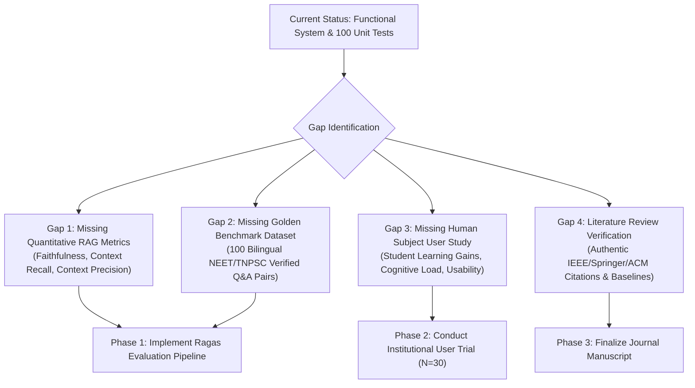
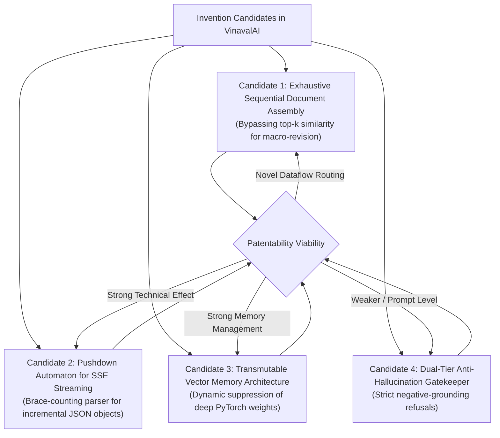
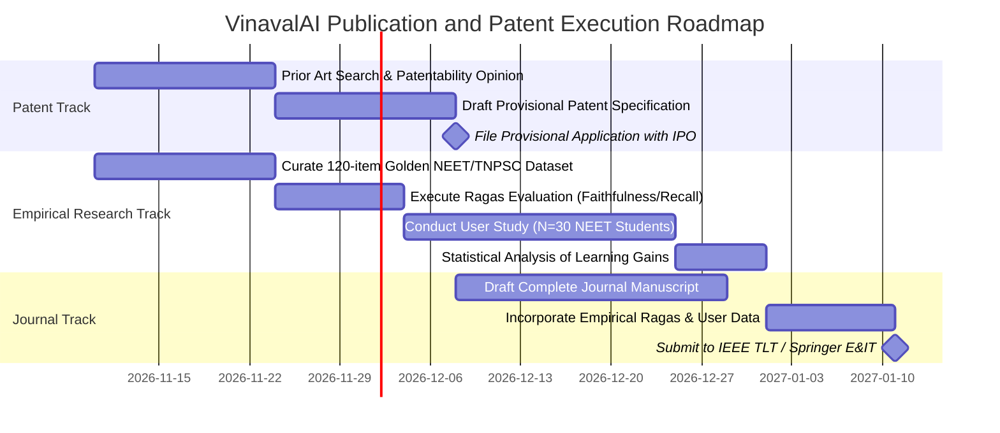

# Research Gaps, Patent Readiness, and Developer Action Plan

**Document Type:** Strategic Assessment & Developer Roadmap for Academic Publication and Patent Filing
**Project:** VinavalAI
**Date:** November 2026
**Document Ref:** `docs/research_and_patent/05_vinavalai_research_and_patent_readiness.md`
**Target Stakeholders:** Academic Authors, Principal Investigators, Institutional Patent Cell, Lead Developers

---

## 1. Executive Assessment

While VinavalAI represents a sophisticated, end-to-end full-stack educational AI system with 100 passing automated unit/integration tests and verified live operations, there are distinct differences between an **engineered software product** and a **submission-ready academic journal paper** or **granted patent**.

This document outlines the exact experimental, empirical, and legal gaps that must be addressed prior to formal journal submission or patent filing, providing an actionable roadmap for the development team.

---

## 2. Academic Research Gaps & Validation Requirements



### 2.1 Missing Quantitative RAG Metrics
Currently, the repository contains unit tests validating that retrieval functions execute without error, but **zero quantitative retrieval or generation accuracy benchmarks exist**:
- **Context Recall ($R_{\text{context}}$):** Did the top-$k$ retrieved chunks contain the ground-truth information required to answer the question?
- **Context Precision ($P_{\text{context}}$):** Were all retrieved chunks relevant, or did non-relevant chunks dilute the prompt context?
- **Faithfulness / Groundedness ($F$):** Did the LLM answer strictly from the retrieved context, or did it introduce external hallucinations?
- **Answer Relevancy ($A_{\text{rel}}$):** Did the generated explanation directly address the student's question?

#### Recommended Action Plan:
Introduce the open-source evaluation framework `ragas` into `backend/requirements-dev.txt`:
```bash
pip install ragas langchain-openai datasets
```
Implement an offline evaluation script (`backend/scripts/evaluate_rag.py`) that computes standard metrics across a verified golden dataset.

---

### 2.2 Golden Benchmark Dataset Creation Protocol
To support an academic publication in IEEE Transactions on Learning Technologies or Springer Education and Information Technologies, the authors must compile and release a benchmark dataset:

| Examination | Subject | Question Count | Language Split | Content Specification |
|---|---|---|---|---|
| **NEET** | Physics | 30 | 15 EN / 15 TA | Mechanics, Electromagnetism, Optics (Numerical + Derivation) |
| **NEET** | Chemistry | 30 | 15 EN / 15 TA | Organic Mechanisms, Equilibrium, Chemical Kinetics |
| **NEET** | Biology | 40 | 20 EN / 20 TA | Cell Biology, Genetics, Human Physiology |
| **TNPSC** | History / Polity | 20 | 10 EN / 10 TA | Indian Constitution, Freedom Struggle in Tamil Nadu |
| **Total** | — | **120** | **60 EN / 60 TA** | Each item includes: Question, Verified Textbook Chunk Citation, Ground Truth Answer, Bilingual Terminology Glossary |

---

### 2.3 Human Subject User Study Protocol
A publication in top-tier educational technology journals requires evidence of pedagogical efficacy:
- **Study Design:** A between-subjects or within-subjects randomized controlled trial (RCT) with $N = 30$ to $50$ secondary school students preparing for NEET in Tamil Nadu.
- **Evaluation Arms:**
  - *Control Group:* Traditional self-study with standard NCERT digital textbooks and generic commercial LLM (e.g., ChatGPT web interface).
  - *Intervention Group:* VinavalAI platform (AI Tutor, MyStudyGPT with coaching PDF, Exam Lab with deterministic diagnostics, Smart Notes).
- **Measurement Instruments:**
  1. *Pre-Test & Post-Test:* Identical 25-question multiple-choice exams assessing conceptual understanding and numerical accuracy.
  2. *System Usability Scale (SUS):* 10-item standard questionnaire evaluating user experience.
  3. *NASA-TLX (Task Load Index):* Measuring subjective mental demand, frustration, and cognitive effort during revision.

---

## 3. Patent Readiness Assessment & Invention Distinctions



### 3.1 Patentability Analysis under Indian Patent Law (Section 3(k))
Under Section 3(k) of the Indian Patents Act, 1970, pure software algorithms and mathematical methods are non-patentable unless they produce a **further technical effect** or solve a **technical problem within the computing system**.

#### Viability Ranking of VinavalAI Mechanisms:
1. **Candidate 2: Pushdown Automaton for Streaming JSON (High Viability):**
   - *Technical Contribution:* Solves a concrete data processing and network I/O latency problem. Reduces First-Token Latency (TTFT) by eliminating the JSON array buffering stall at the network layer.
   - *Patent Strength:* Strong technical effect demonstrable on operating system sockets and buffer streams.
2. **Candidate 3: Transmutable Vector Memory Architecture (High Viability):**
   - *Technical Contribution:* Dynamic physical memory optimization. Suppresses allocation of PyTorch tensor memory ($1.13\text{ GB} \to 180\text{ MB}$), directly preventing OS process termination (SIGKILL / OOM).
   - *Patent Strength:* Direct, measurable interaction with physical system memory and process management.
3. **Candidate 1: Exhaustive Sequential Document Assembly (Medium Viability):**
   - *Technical Contribution:* A non-obvious database query routing mechanism that inverts conventional RAG by querying on foreign key metadata (`where={"doc_id": did}`) and sequentially ordering chunks, relegating similarity search to fallback.
   - *Challenge:* Risk of being characterized as a database retrieval schema rather than a patentable technical mechanism unless framed around memory-constrained document context reconstruction.
4. **Candidate 4: Dual-Tier Negative-Grounding Gatekeeper (Low Viability):**
   - *Challenge:* Relies predominantly on natural language prompt instructions (`SYSTEM_PROMPT`). Prompt engineering per se is generally considered a non-patentable linguistic configuration rather than a technical invention.

---

### 3.2 Prior-Art Search & Public Disclosure Risks
- **Prior-Art Search Databases:**
  - *Indian Patent Advanced Search System (InPASS):* Search terms: `((retrieval augmented generation) AND (stream OR json) AND (pedagogical OR educational))`.
  - *Google Patents & Espacenet (EPO):* Search CPC classifications `G06F 16/33`, `G06N 3/00`, `G09B 7/02`.
- **Public Disclosure Analysis:**
  - Public GitHub commits exist in the repository (e.g., commit `4d536d5` on branch `main`).
  - *US Law (35 U.S.C. § 102(b)):* Provides a 1-year inventor grace period from the date of public repository disclosure.
  - *Indian Law (Section 31):* Does not provide a broad commercial grace period; public disclosure without filing may be cited as prior art by an examiner.
  - *Action:* If patent filing is pursued, a **Provisional Patent Application** must be filed with the Indian Patent Office immediately before any arXiv pre-print or public launch.

---

## 4. Developer Clarifications Required

To resolve ambiguities and strengthen both the academic manuscript and the patent specification, the project developers should clarify the following technical decisions:

1. **TNPSC AI Tutor Frontend Activation:**
   - *Question:* Why was the TNPSC AI Tutor chat blocked in the React frontend (`<TnpscComingSoon />`) despite backend support and pre-seeded vector collections existing in `chain.py`?
   - *Context Needed:* Is there an incomplete Tamil language dataset, pending curriculum verification, or an intentional business rollout staging?
2. **PostgreSQL Migration Plan on Render:**
   - *Question:* Is there an active plan to migrate from ephemeral SQLite (`vinavalai.db`) to managed PostgreSQL on Render?
   - *Context Needed:* In production environments, an ephemeral SQLite database loses all student accounts, notes, and quiz histories on every restart.
3. **Curated Textbook Licensing:**
   - *Question:* What is the copyright and licensing provenance of the PDF/TXT textbooks ingested in `backend/books/` and seeded into ChromaDB?
   - *Context Needed:* Academic journals require explicit statements regarding textbook copyright compliance (e.g., open NCERT educational re-use licensing).
4. **Google Gemini Production Quotas:**
   - *Question:* What is the planned production tier for Google Gemini API?
   - *Context Needed:* In the local development environment, `GEMINI_API_KEY` is invalid, causing runtime failover to Groq. What tier will be used in commercial deployment?

---

## 5. Actionable Roadmap for Publication & Patent Filing



### Immediate Action Items:
1. **Week 1–2 (Patent First):** Present Candidate 2 (Pushdown Automaton) and Candidate 3 (Transmutable Memory Architecture) to the institutional patent cell / patent attorney. File a provisional patent application before public manuscript dissemination.
2. **Week 3–4 (Benchmark Construction):** Curate the 120-item bilingual NEET/TNPSC golden evaluation set with ground-truth citations.
3. **Week 5–6 (Ragas Evaluation):** Run automated benchmarking to produce quantitative Context Precision, Context Recall, and Faithfulness scores.
4. **Week 7–9 (Human Evaluation):** Conduct the 30-student usability trial measuring learning gains and System Usability Scale (SUS) scores.
5. **Week 10 (Submission):** Submit the finalized, evidence-backed manuscript to a peer-reviewed academic journal.
